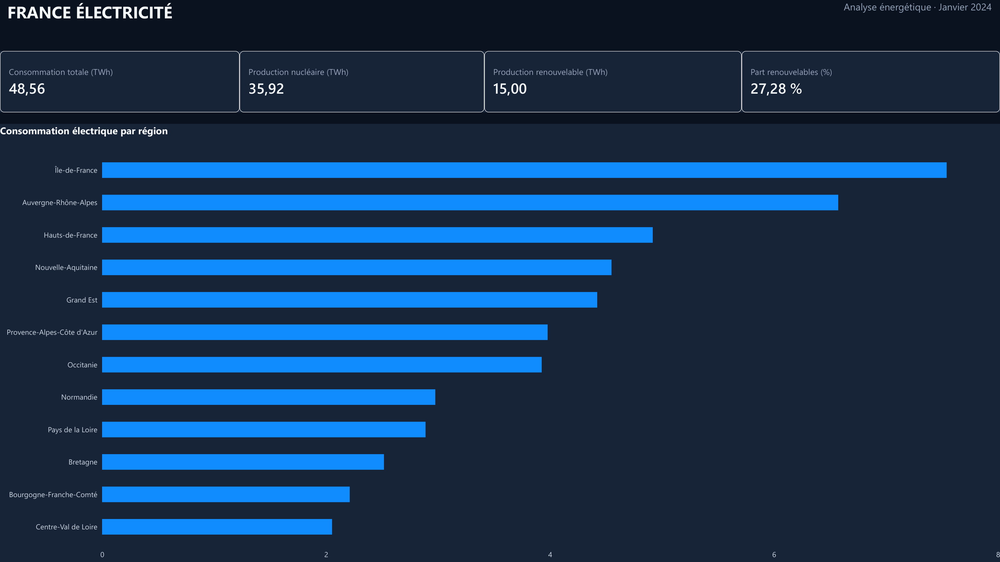
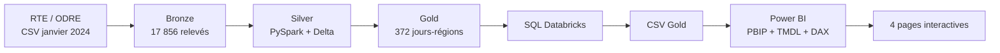

# France Électricité 2024 — Databricks & Power BI

**Projet Data Analyst · RTE/ODRÉ · Janvier 2024**

Pipeline de données complet, de la collecte d'informations ouvertes sur l'électricité en France à un tableau de bord Power BI interactif.

**Stack réellement utilisée :** Databricks Free Edition · PySpark · Delta Lake · SQL · Power BI Desktop · Power Query · DAX · PBIP/TMDL. **Microsoft Fabric n'a pas été utilisé.**

## Objectif et périmètre

Étudier la consommation d'électricité, la production par filière et les différences régionales en France métropolitaine pour **janvier 2024**. L'étude couvre **12 régions** et repose sur des données régionales à la demi-heure : 31 jours × 12 régions × 48 pas demi-horaires = **17 856 observations**. Ce n'est **pas une analyse de l'année 2024 entière**.

Source : **RTE / ODRE**, jeu [éCO2mix régionales consolidées et définitives](https://odre.opendatasoft.com/explore/dataset/eco2mix-regional-cons-def/), données de nature définitive, janvier 2024. Licence des données : **Licence Ouverte 2.0 / Etalab** (voir [attribution](LICENSE-DATA.md)).

## Résultats — janvier 2024

| Indicateur | Valeur |
|---|---:|
| Consommation | **48,56 TWh** |
| Production des 6 filières étudiées | **54,97 TWh** |
| Nucléaire | 35,92 TWh |
| Renouvelables (hydraulique, éolien, solaire, bioénergies) | 15,00 TWh |
| Thermique | 4,05 TWh |
| Part des renouvelables **dans la production étudiée** | **27,28 %** |
| Ratio production étudiée / consommation | **113,20 %** |

Pour les renouvelables : hydraulique 7,80 TWh, éolien 5,45 TWh, solaire 0,85 TWh, bioénergies 0,89 TWh. Les sommes des valeurs affichées peuvent différer légèrement des totaux, car les chiffres sont arrondis séparément.

**Interprétation :** le ratio de couverture mensuel ne prouve pas que la production couvre la demande à chaque instant, ni que la différence correspond exactement à des exportations. Les volumes sont ceux du **périmètre régional RTE et des six filières retenues dans ce modèle** ; ils ne sont pas une validation externe du bilan électrique national. Les échanges, le pompage et les autres mécanismes d'équilibrage ne sont pas analysés ici.

## Architecture

- **Bronze :** import CSV brut via `spark.read.csv` (32 colonnes). Note : Bronze est le **niveau logique d'ingestion du CSV**, et **pas une table Delta Bronze persistée** dans les notebooks actuels.
- **Silver :** typage, normalisation des noms, nettoyage, contrôle qualité puis table Delta `workspace.default.silver_energie` (31 colonnes).
- **Gold :** agrégation région × jour (372 lignes), tables Delta `fact_energie`, `dim_date`, `dim_region` dans `workspace.default`.
- **Modèle BI :** schéma en étoile avec relations 1→* depuis les deux dimensions vers `fact_energie`.

Comme les données de puissance sont exprimées en MW et que chaque pas dure 30 minutes, les énergies journalières sont calculées par : **MWh = Σ(MW × 0,5 h)**. Les mesures DAX convertissent les MWh en TWh par division par 1 000 000.

## Structure du dépôt

| Chemin | Fonction |
|---|---|
| [`notebooks/`](notebooks/) | 4 notebooks PySpark Databricks **exportés à l'identique** |
| [`sql/`](sql/) | 6 requêtes SQL issues du SQL Editor Databricks |
| [`powerbi/`](powerbi/) | Rapport PBIP, Semantic Model TMDL et mesures DAX |
| [`powerbi/dax/measures.md`](powerbi/dax/measures.md) | Documentation des 12 mesures DAX |
| [`docs/images/`](docs/images/) | 4 captures PNG 16:9 du rapport |
| [`data/demo/`](data/demo/) | 3 petits CSV Gold dérivés du jeu public, permettant d'actualiser Power BI sans Databricks |
| [`docs/architecture.md`](docs/architecture.md) | Explication du pipeline et limites |
| [`scripts/check_repo.py`](scripts/check_repo.py) | Validation statique et contrôle des données de démonstration |

## Dashboard

| Vue | Capture |
|---|---|
| Vue d'ensemble | [01_vue_ensemble.png](docs/images/01_vue_ensemble.png) |
| Consommation et segments région/date | [02_consommation.png](docs/images/02_consommation.png) |
| Évolution nucléaire vs renouvelables | [03_evolution_energetique.png](docs/images/03_evolution_energetique.png) |
| Analyse régionale | [04_analyse_regionale.png](docs/images/04_analyse_regionale.png) |

La page `Contrôle E6` est masquée dans Power BI mais conservée pour l'audit des indicateurs. La synchronisation des segments régionaux et temporels a été testée lors de la réalisation du rapport.

## Ouvrir le rapport Power BI sans Databricks

1. Cloner ou télécharger ce dépôt.
2. Ouvrir **`powerbi/France_Electricite_2024.pbip`** dans Power BI Desktop.
3. Dans **Accueil → Transformer les données → Gérer les paramètres**, régler `DataRoot` sur le chemin absolu du dossier `data/demo/` sur votre ordinateur, **avec le séparateur final** `\` sous Windows. Exemple : `D:\projets\france-electricite-fabric-powerbi\data\demo\`.
4. **Fermer & appliquer**, puis **Actualiser** les données.
5. Contrôler les indicateurs ci-dessus et l'apparence des quatre pages.

Le projet PBIP versionné **exclut volontairement les caches et les réglages propres à un poste**. Sans actualisation sur un jeu de données accessible, les visuels peuvent donc être vides. La validité d'ouverture du PBIP modifié doit être vérifiée dans Power BI Desktop après téléchargement ; nos contrôles automatisés sont statiques.

## Reproduire le pipeline Databricks

Voir [instructions sur les données](data/README.md).

1. Exporter depuis ODRE les **données définitives de janvier 2024** en CSV avec séparateur `;`, en conservant les noms de colonnes.
2. Charger le CSV sous `/Volumes/workspace/default/bronze/eco2mix-regional-cons-def.csv` dans un workspace Databricks disposant de Unity Catalog (adapter chemin, catalogue et schéma pour un autre workspace).
3. Importer les notebooks `.py` du dossier `notebooks/` et les lancer dans cet ordre : `00_setup_energie`, `01_ingestion_rte`, `02_transformation_silver`, `03_transformation_gold`.
4. Lancer les six requêtes du dossier `sql/`.
5. Exporter les trois tables Gold en CSV vers le même répertoire local, ou utiliser directement les CSV de démonstration fournis.

Le code source utilise des spécificités Databricks (`spark`, `display`, `/Volumes/...`, Unity Catalog), et n'est **pas directement exécutable dans un Python standard** sans adaptation. Le pipeline n'a pas été relancé indépendamment pour cette publication.

## Vérifications et limites

- Données Gold de démonstration : 372 observations, 31 jours, 12 régions et 48 relevés par groupe date-région.
- DAX : 12 mesures métier et de contrôle dans le Semantic Model ; la mesure vide d'essai a été retirée du PBIP versionné.
- SQL / PySpark : sources originales vérifiées statiquement, avec limites de contrôle des valeurs manquantes signalées.
- Le contenu de `data/demo/` provient d'un export Gold réalisé à partir des données ouvertes. Il ne se substitue pas aux sources brutes et peut être soumis à la licence de données d'origine.
- Les CSV complets bruts et les caches Power BI **ne sont pas dans Git**.
- Sources RTE et métriques **non indépendamment réconciliées** avec un nouveau téléchargement du producteur.

## Version & licences

Le code, les notebooks, le SQL et la documentation originale sont sous licence [MIT](LICENSE). Les données et dérivés RTE/ODRE restent sous [Licence Ouverte 2.0](LICENSE-DATA.md).

Projet personnel Data Analyst, 2026. Les visualisations et interprétations sont réalisées à titre pédagogique, sans approbation ni affiliation de RTE.
