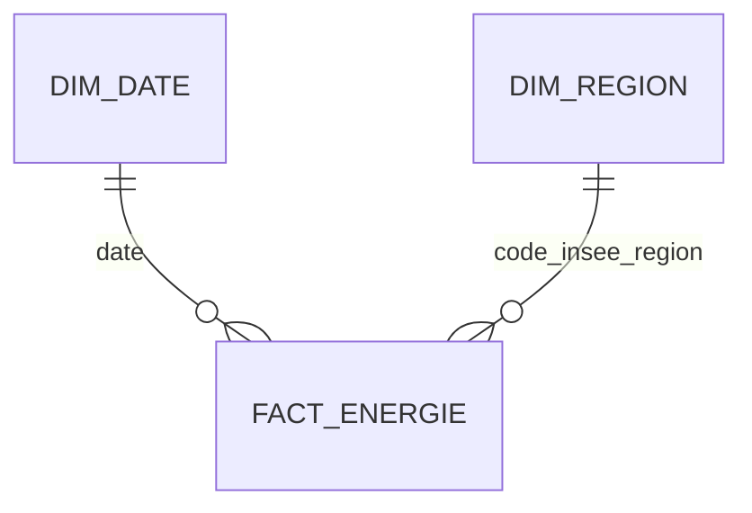

# Architecture et limites analytiques

## Flux de données

1. **RTE / ODRE** : CSV demi-horaire de janvier 2024, filtré sur les données définitives.
2. **Bronze logique** : `spark.read.csv` conserve les valeurs en texte pour l'inspection ; **aucune table Bronze persistée** n'a été créée dans les notebooks.
3. **Silver** : vérification des vides, typage et normalisation, table Delta `workspace.default.silver_energie`.
4. **Gold** : 372 couples région-jour, trois tables Delta et contrôles d'intégrité.
5. **SQL** : jointures, KPI et extraction vers CSV.
6. **Power BI** : modèle en étoile (dim_date et dim_region filtrent fact_energie), mesures DAX et 4 pages interactives.

### Schéma en étoile

### Conversion MW en MWh

Les valeurs du CSV représentent des puissances demi-horaires. Par pas de 30 minutes, l'énergie est `MW × 0,5 h`. Pour une journée complète : `Σ(MW) × 0,5` = MWh, puis `MWh / 1e6` = TWh.

## Validation réalisée

- `fact_energie` : 372 lignes, 31 jours, 12 régions, 48 pas par couple date-région, aucun doublon observé dans les exports du projet.
- Les clés date/région sont présentes dans les dimensions.
- Somme des quatre filières renouvelables = total renouvelable, à quatre décimales TWh affichées.
- Les mesures DAX et relations sont extraites du modèle TMDL original ; la mesure d'essai vide n'était pas référencée par les visuels et a été retirée du projet versionné.

## Réserves à déclarer

- Pas de ré-exécution indépendante des notebooks dans Databricks durant cet audit ; seul leur code a été inspecté.
- Le contrôle de 48 enregistrements par jour/région ne prouve pas à lui seul l'absence de valeurs de mesure manquantes ou de doublons horaires compensés.
- SQL E4.3 additionne plusieurs colonnes ; des `NULL` peuvent influencer certaines sommes. Sur l'export Gold de démonstration, les sept valeurs de mesure sont renseignées.
- Le ratio de production / consommation est un ratio **sur volumes mensuels agrégés** et ne représente pas la couverture heure par heure ou les exportations.
- La part renouvelable porte sur la production des six filières étudiées, **pas la part des renouvelables dans la consommation**.
- Le projet Power BI PBIP modifié (paramètre `DataRoot`) nécessite une validation d'ouverture et d'actualisation dans Power BI Desktop sur Windows.
